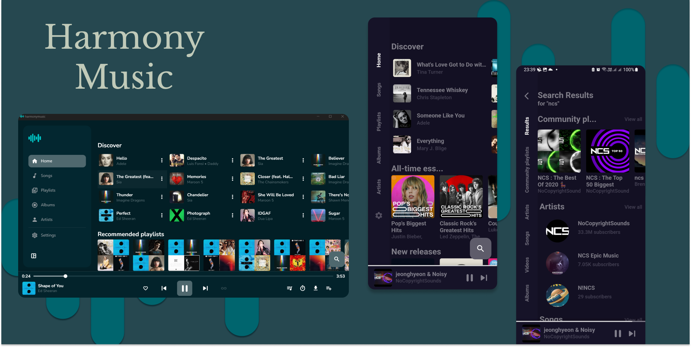

<div align="center">


# Symphony Music

A modern, fast, and open-source music streaming application for Android and Desktop.

[](https://github.com/Tanatos-theOnly/Symphony-Music/releases/latest)
[](https://flutter.dev)
[](LICENSE)
[]()

<br />

[**Download Latest APK**](https://github.com/Tanatos-theOnly/Symphony-Music/releases/latest) • [**Report an Issue**](https://github.com/Tanatos-theOnly/Symphony-Music/issues) • [**Changelog**](CHANGELOG.md)

<br />



</div>

## Overview

Symphony Music is an open-source, ad-free music streaming app built with Flutter. It lets you stream, discover, and download music directly with zero subscription fees, no user accounts, and complete privacy.

---

## Features

- **Ad-Free Streaming**: Seamless background playback with no ads or interruptions.
- **Offline Downloads**: High-speed song downloading with chunked stream buffering and audio tag metadata embedding.
- **Synchronized Lyrics**: Real-time synchronized lyrics support powered by LRCLIB.
- **Audio Equalizer**: Native 10-band hardware equalizer with bass boost and virtualizer.
- **Smart Recommendations**: Smart content discovery based on your recently played music.
- **Dynamic Theming**: Adapts dynamically to your device wallpaper or custom color themes.
- **Android Auto & Background Play**: Full integration with Android Auto, notification controls, and lockscreen media session.
- **Sleep Timer & Skip Silence**: Built-in sleep timer and audio processing to remove silent intervals.
- **In-App Updates**: Built-in release detector to download and install new updates with one tap.

---

## Download

Get the latest stable release for Android directly from GitHub:

| Platform | Download Link | Notes |
| :--- | :--- | :--- |
| **Android** | [**app-release.apk**](https://github.com/Tanatos-theOnly/Symphony-Music/releases/latest) | Universal build (`arm64-v8a`, `armeabi-v7a`, `x86_64`) |

> **Installation note**: If Android displays an *Unknown Sources* prompt during installation, tap **Settings** and allow installs from your browser or file manager.

---

## Building from Source

### Prerequisites
- Flutter SDK (3.x or later)
- Android SDK & JDK 17
- Git

### Build Steps

```bash
# Clone the repository
git clone https://github.com/Tanatos-theOnly/Symphony-Music.git
cd Symphony-Music

# Fetch dependencies
flutter pub get

# Build the release APK
flutter build apk --release
```

The compiled APK will be output to:  
`build/app/outputs/flutter-apk/app-release.apk`

---

## License

This project is licensed under the **GNU General Public License v3.0** (GPL-3.0). See the [LICENSE](LICENSE) file for full details.
